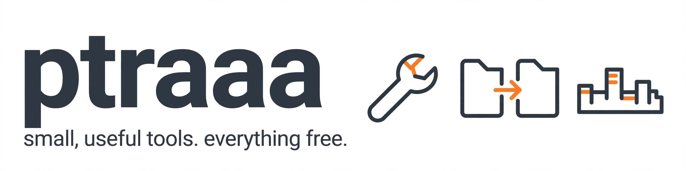

# ptraaa

Indonesian builder of small tools that earn their keep. I build in public, ship small and often, and everything below is live and free to use.

Lived by your own thinking.

## Live products

- [ZeroServer](https://ptraaah.github.io/zeroserver/) - send files straight from one browser to another: no file server, no account, no size limit set by a service. One single HTML file, verified with SHA-256 on arrival. Now at v1.3, with a TURN relay for when a direct connection is blocked, tested on the same network and across different ones. [Source](https://github.com/Ptraaah/zeroserver)
- [AMERTA Roleplay](https://amerta.pages.dev) - a living SA-MP / open.mp roleplay city: player economy, jobs with EXP levels, elections, documents and licences, running live. [Join the Discord](https://discord.gg/qTVC7px7sV)

## Open source contributions

Merged into other people's projects:

- [Prestashop-MCP-Server](https://github.com/novalo-dev/Prestashop-MCP-Server/pull/160) - the somcp_list_return_statuses tool, shipped in release 1.1.2
- [Prestashop-MCP-Server](https://github.com/novalo-dev/Prestashop-MCP-Server/pull/162) - the somcp_create_return_status tool
- [arcpanel](https://github.com/arc-panel-oss/arcpanel/pull/22) - BATS tests for the timezone listing
- [arcpanel](https://github.com/arc-panel-oss/arcpanel/pull/24) - BATS tests for shells and database types
- [arcpanel](https://github.com/arc-panel-oss/arcpanel/pull/25) - BATS tests for user packages and DNS templates
- [arcpanel](https://github.com/arc-panel-oss/arcpanel/pull/26) - a locale script fix that took a converter from 0 locales working to all 42
- [yazses](https://github.com/MSKazemi/yazses/pull/743) - native-speaker review of the Indonesian docs; I am the project's Indonesian reviewer now
- [gslider-blocks](https://github.com/noruzzamans/gslider-blocks/pull/563) - test fixes for the style generator; I am listed in the repo's contributors

In review or assigned right now:

- [WooCommerce](https://github.com/woocommerce/woocommerce/pull/70479) - what a customer spent within a chosen date range, for both order storage modes
- [career-ops](https://github.com/career-ops-hq/career-ops/pull/6364) - the Indonesian README; the other translator thanked me in public and closed his own draft in my favour
- [Prestashop-MCP-Server](https://github.com/novalo-dev/Prestashop-MCP-Server/pull/163) - the somcp_update_return_status tool, with the [somcp_create_order_status tool](https://github.com/novalo-dev/Prestashop-MCP-Server/pull/165) right behind it
- [floe](https://github.com/jannskiee/floe/pull/843) - desktop shortcuts no longer die while the settings switches hold focus
- [moodle-theme_boost_union](https://github.com/moodle-an-hochschulen/moodle-theme_boost_union/pull/1468) - an admin setting for link decoration
- [gslider-blocks](https://github.com/noruzzamans/gslider-blocks/pull/564) - the admin dashboard made translation-ready
- [watch-tower](https://github.com/Andrewpk/watch-tower/pull/105) - a connection filter for the queries page
- [reader](https://github.com/jzheaux/reader/pull/211) - failing element checks that fail fast instead of hanging the test run, plus [keyboard behaviour tests](https://github.com/jzheaux/reader/pull/210)
- [Sniffnet](https://github.com/GyulyVGC/sniffnet/pull/1345) - completing the Indonesian translation
- [DIO](https://github.com/nisaral/DIO/pull/31) - a --version flag and a check-config command, with tests
- [parliament-streams](https://github.com/dlq/parliament-streams/pull/68) - native review of the Indonesian site texts
- [cryptex](https://github.com/gungortarik/cryptex/pull/22) - negative-path tests for the MCP server
- [sony-inzone-buds-linux](https://github.com/RavenEibu/sony-inzone-buds-linux/pull/34) - native review of the Indonesian translation

## Small tools, one job each

- [LivingCity](https://github.com/Ptraaah/livingcity) - a city that lives without players: virtual-citizen economy engine for SA-MP / open.mp, distilled from AMERTA's city design
- [WP Jaga](https://github.com/Ptraaah/wp-jaga) - one-click WordPress hardening plugin, small enough to read end to end
- [toko-wa](https://github.com/Ptraaah/toko-wa) - free one-file online store template, orders land in WhatsApp
- [undangan-digital](https://github.com/Ptraaah/undangan-digital) - free one-file digital wedding invitation template
- [envguard](https://github.com/Ptraaah/envguard) - audits .env files for missing keys, placeholder and weak secrets, and leaked values
- [linkrot](https://github.com/Ptraaah/linkrot) - dead link checker for sitemaps and sites
- [imgsqueeze](https://github.com/Ptraaah/imgsqueeze) - batch image compressor for the web
- [samp-query](https://github.com/Ptraaah/samp-query) - SA-MP / open.mp server query tool and library, zero dependencies
- [samp-jobexp](https://github.com/Ptraaah/samp-jobexp) - job EXP and level system include for SA-MP / open.mp
- [samp-cfgcheck](https://github.com/Ptraaah/samp-cfgcheck) - validates SA-MP server.cfg files, zero dependencies
- [romcheck](https://github.com/Ptraaah/romcheck) - checks N64 ROM headers, identities and hashes
- [wp-plugin-triage](https://github.com/Ptraaah/wp-plugin-triage) - first-pass security triage for WordPress plugins

## Support

Everything I make stays free. If a tool saved you time, you can support the next one:

- [GitHub Sponsors](https://github.com/sponsors/Ptraaah)
- [Trakteer](https://trakteer.id/adel_putra2) for supporters in Indonesia
